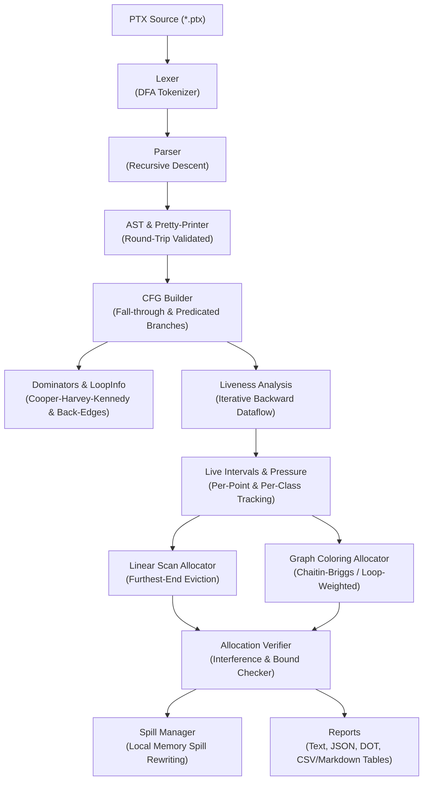

# PTXRA: PTX Register Allocator & Analysis Toolkit

PTXRA is an end-to-end NVIDIA PTX compiler toolkit written in **modern C++17** with zero external dependencies (GoogleTest fetched only for test suites). It parses PTX assembly, builds Control-Flow Graphs (CFGs), computes dominator trees and loop nesting structures, runs backward liveness analysis to calculate register pressure per program point, and implements two classic register allocators:
1. **Linear Scan (Poletto & Sarkar)**
2. **Graph Coloring with Optimistic Spilling (Chaitin-Briggs)**

Every allocation is automatically verified against four mathematical invariants via an integrated formal verifier.

---

## Architecture



---

## Features

- **Strict C++17 Standard**: Compiles with `-Wall -Wextra -Wpedantic -Werror` with zero warnings.
- **Robust Front-End**: Supports `.version`, `.target`, `.address_size`, `.visible`, `.entry`, `.func`, `.param`, `.reg` (ranges `%r<10>` and discrete), `.shared`, `.local`, instructions with modifier dot-chains (`mad.lo.s32`, `fma.rn.f32`, `st.global.f32`), and predicated execution (`@%p0`, `@!%p0`).
- **Control-Flow Analysis**:
  - Cooper-Harvey-Kennedy dominators in Reverse Post-Order (RPO).
  - Natural loop detection via back-edge identification with nesting depths.
  - Graphviz DOT emission with detailed basic block information.
- **Liveness & Pressure**:
  - Block-level $\text{def}$, $\text{use}$, $\text{liveIn}$, $\text{liveOut}$ sets.
  - Fine-grained program-point intervals ($2i$ use, $2i+1$ def).
  - Peak register pressure tracking across 5 register classes: `pred`, `int32`, `int64`, `float32`, `float64`.
- **Allocators**:
  - **Linear Scan**: Fast $O(N \log N)$ interval traversal with furthest-end eviction.
  - **Graph Coloring**: Chaitin-Briggs interference graph with loop-depth weighted spill costs ($10^{\text{depth}} / \text{degree}$), Simplify, optimistic Spill, and Select phases.
- **Formal Verifier**: Guarantees zero overlapping live ranges share physical registers, enforces register class constraints, and verifies spill consistency.
- **ptxas Compatibility Harness**: Optional detection of CUDA toolkit (`nvcc` / `ptxas -v`); pre-generated sample `.ptx` files enable standalone execution on any machine.

---

## Build & Test Instructions

### Requirements
- C++17 compliant compiler (`clang++` $\ge$ 10 or `g++` $\ge$ 9)
- CMake $\ge$ 3.16

### Building from Source

```bash
# Configure and build in Release mode
cmake -B build -DCMAKE_BUILD_TYPE=Release
cmake --build build -j

# Run the full test suite (10 test suites)
ctest --test-dir build --output-on-failure
```

### Running with Sanitizers (ASan + UBSan)

```bash
cmake -B build -DCMAKE_BUILD_TYPE=Debug -DCMAKE_CXX_FLAGS="-fsanitize=address,undefined -fno-omit-frame-pointer"
cmake --build build -j
ctest --test-dir build --output-on-failure
```

---

## CLI Usage

The `ptxra` binary provides six subcommands:

```bash
# 1. Parse and print summary (or --print for canonical PTX round-trip)
./build/ptxra parse samples/vector_add.ptx

# 2. Control-flow graph report (or --dot for Graphviz visual output)
./build/ptxra cfg samples/vector_add.ptx --dot > vector_add.dot

# 3. Liveness analysis (live-in / live-out sets per block)
./build/ptxra liveness samples/vector_add.ptx

# 4. Register pressure analysis (peak overall and per register class)
./build/ptxra pressure samples/vector_add.ptx

# 5. Register allocation with automatic verification
./build/ptxra alloc samples/heavy_pressure.ptx --algo=graph --max-regs=8

# 6. Comparative benchmark table across allocators
./build/ptxra compare samples/heavy_pressure.ptx --max-regs=8
```

---

## Benchmark Comparison Summary

Real runs across all 11 realistic & stress kernels in `samples/` comparing **Linear Scan** vs **Graph Coloring** across 5 budgets (16, 24, 32, 64, 255):

> The full 110-entry evaluation dataset is available in [`benchmark_results.md`](benchmark_results.md) and [`benchmark_results.csv`](benchmark_results.csv).

### Evaluation Overview

| Kernel | Budget | Allocator | Slots Used | Spill Stores | Spill Loads | Weighted Spill Cost |
| :--- | :---: | :---: | :---: | :---: | :---: | :---: |
| `vector_add` | 16 / 24 / 32 / 64 / 255 | LinearScan | 8 | 0 | 0 | 0 |
| `vector_add` | 16 / 24 / 32 / 64 / 255 | GraphColoring | 8 | 0 | 0 | 0 |
| `saxpy` | 16 / 24 / 32 / 64 / 255 | LinearScan | 8 | 0 | 0 | 0 |
| `saxpy` | 16 / 24 / 32 / 64 / 255 | GraphColoring | 8 | 0 | 0 | 0 |
| `divergent` | 16 / 24 / 32 / 64 / 255 | LinearScan | 8 | 0 | 0 | 0 |
| `divergent` | 16 / 24 / 32 / 64 / 255 | GraphColoring | 6 | 0 | 0 | 0 |
| `block_reduce` | 16 / 24 / 32 / 64 / 255 | LinearScan | 10 | 0 | 0 | 0 |
| `block_reduce` | 16 / 24 / 32 / 64 / 255 | GraphColoring | 8 | 0 | 0 | 0 |
| `stencil_2d` | 16 / 24 / 32 / 64 / 255 | LinearScan | 16 | 0 | 0 | 0 |
| `stencil_2d` | 16 / 24 / 32 / 64 / 255 | GraphColoring | 13 | 0 | 0 | 0 |
| `live_range_hole` | 16 / 24 / 32 / 64 / 255 | LinearScan | 12 | 0 | 0 | 0 |
| `live_range_hole` | 16 / 24 / 32 / 64 / 255 | GraphColoring | 8 | 0 | 0 | 0 |
| `long_lived` | 16 / 24 / 32 / 64 / 255 | LinearScan | 15 | 0 | 0 | 0 |
| `long_lived` | 16 / 24 / 32 / 64 / 255 | GraphColoring | 11–12 | 0 | 0 | 0 |
| `matmul` | 16 | LinearScan | 16 | 10 | 22 | 437 |
| `matmul` | 16 | GraphColoring | 16 | 2 | 2 | 13 |
| `matmul` | 24 / 32 / 64 / 255 | LinearScan | 20 | 0 | 0 | 0 |
| `matmul` | 24 / 32 / 64 / 255 | GraphColoring | 17 | 0 | 0 | 0 |
| `heavy_pressure` | 16 | LinearScan | 16 | 16 | 24 | 229 |
| `heavy_pressure` | 16 | GraphColoring | 16 | 10 | 29 | 129 |
| `heavy_pressure` | 24 | LinearScan | 24 | 2 | 3 | 5 |
| `heavy_pressure` | 24 / 32 / 64 / 255 | GraphColoring | 22 | 0 | 0 | 0 |
| `heavy_pressure` | 32 / 64 / 255 | LinearScan | 26 | 0 | 0 | 0 |
| `nested_loops` | 16 | LinearScan | 16 | 6 | 7 | 247 |
| `nested_loops` | 16 | GraphColoring | 16 | 3 | 4 | 106 |
| `nested_loops` | 24 / 32 / 64 / 255 | LinearScan | 18 | 0 | 0 | 0 |
| `nested_loops` | 24 / 32 / 64 / 255 | GraphColoring | 19 | 0 | 0 | 0 |
| `fma_chain` | 16 | LinearScan | 16 | 37 | 38 | 75 |
| `fma_chain` | 16 | GraphColoring | 16 | 37 | 37 | 74 |
| `fma_chain` | 24 | LinearScan | 24 | 29 | 30 | 59 |
| `fma_chain` | 24 | GraphColoring | 24 | 29 | 29 | 58 |
| `fma_chain` | 32 | LinearScan | 32 | 21 | 22 | 43 |
| `fma_chain` | 32 | GraphColoring | 32 | 21 | 21 | 42 |
| `fma_chain` | 64 / 255 | LinearScan | 52 | 0 | 0 | 0 |
| `fma_chain` | 64 / 255 | GraphColoring | 52 | 0 | 0 | 0 |

---

## Test Coverage (gcov)

Line coverage measured with `gcov` across all source components:

| Component | Lines Covered | Total Lines | Line Coverage |
| :--- | :---: | :---: | :---: |
| `src/analysis` | 149 | 155 | 96.1% |
| `src/cfg` | 335 | 367 | 91.3% |
| `src/regalloc` | 486 | 580 | 83.8% |
| `src/parser` | 298 | 402 | 74.1% |
| `src/ir` | 131 | 193 | 67.9% |
| `src/report` | 105 | 161 | 65.2% |
| `src/ast` | 186 | 293 | 63.5% |
| `src/lexer` | 244 | 411 | 59.4% |
| **Total** | **1934** | **2562** | **75.5%** |

---

## Limitations

1. **Hand-Written PTX Samples**: The sample files in `samples/*.ptx` are realistic handcrafted PTX kernels modeled after `nvcc` output to enable standalone testing without a CUDA installation.
2. **No ptxas Comparison on Host**: Because testing is executed in non-GPU environments without the proprietary NVIDIA CUDA Toolkit or `ptxas` binary installed, ptxas register and stack frame numbers cannot be gathered dynamically on the local runner (the provided `scripts/compare_ptxas.sh` script automates this comparison whenever `nvcc` and `ptxas` are detected in PATH).
3. **No GPU Run**: PTXRA is an offline static analysis, CFG construction, and register allocation toolkit; emitted allocated PTX is not JIT-compiled or dispatched to physical GPU hardware.
4. **Non-SSA Representation**: The current IR is non-SSA. Linear scan uses bounding-box live intervals, while graph coloring uses precise backward per-point liveness sets.
5. **Local Spill Rewriting**: Spills are lowered immediately before uses and after defs in `.local` address space without global rematerialization or store forwarding.
6. **Hardware Microarchitecture Modeling**: GPU hardware warp bank conflicts and dual-issue register constraints are not modeled.

---

## Future Work & Concrete Next Steps

1. **Live-Range Splitting**: Split long live ranges across loop boundaries so values can spill during inner loops and reload afterward, drastically reducing spill traffic.
2. **Conservative Coalescing (George & Briggs criteria)**: Merge non-interfering copy instruction operands (`mov %r1, %r0`) to eliminate redundant register-to-register moves.
3. **Rematerialization**: Identify inexpensive, side-effect-free instructions (constants, address calculations, thread indices `%tid.x`) and recompute them rather than spilling and reloading from memory.
